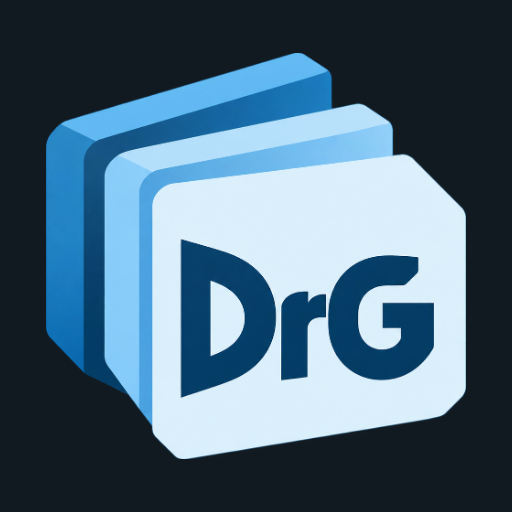

# DrG Space

<p></p>

A self-hosted workspace for notes, projects, reminders, files and conversations. The web interface and installable Web App support Russian and English, desktop and mobile layouts.

[Changelog](CHANGELOG.md) · [Quick start](#quick-start) · [Documentation](#documentation) · [Development](#development-and-checks) · [License](LICENSE)

## Overview

This repository contains the server, web client and installable Web App.

## Features

- Block notes with nested pages, tables, databases, code, attachments, sharing and collaborative editing.
- Notion HTML/Markdown/CSV and Outline imports. Optional Notion synchronization; two-way writing is experimental and off by default.
- Projects, boards, task filters, reminder lists and subtasks; cancellable work with optional reasons and preserved history.
- Private files and folders, expiring download links, quotas and scheduled cleanup.
- Contacts, shared spaces, chat, voice messages and video notes.
- Private WebRTC calls; group calls require an optional LiveKit server.
- Customizable dashboard widgets, themes and wallpapers.
- Account invitations, 2FA, passkeys, administrative controls and encrypted backups.
- SQLite/SQLCipher by default; optional PostgreSQL, Redis and S3-compatible file storage.

## Quick start

Use Python 3.14 to generate the configuration and Docker Compose v2 to run the application. Clone the repository URL supplied by your maintainer into `drg-space`, then:

```sh
cd drg-space
python3 scripts/init-env.py
docker compose up -d --build
docker compose ps
```

Open http://localhost:8000. Read `SETUP_TOKEN` from your local `.env`, create the first owner account, enroll 2FA and save its recovery codes. Never commit `.env` or send its contents to a support channel.

Weather requests identify the deployment using PUBLIC_URL or the optional WEATHER_USER_AGENT setting. Configure your own reachable contact identity and follow the provider terms linked in .env.example.

## Documentation

| Guide | Contents |
| --- | --- |
| [Documentation index](docs/README.md) | Product guides and supported integrations |
| [Installation](INSTALL.md) | Configuration, first startup and deployment |
| [Updates](docs/updates.md) | Upgrade steps and storage compatibility |
| [Security](docs/security.md) | Access, encryption and operational safeguards |
| [Calls](docs/voice-calls.md) | Private calls, TURN and LiveKit |
| [Contributing](CONTRIBUTING.md) | Development conventions and checks |
| [Third-party notices](THIRD_PARTY_NOTICES.md) | Component attribution and licenses |

## Compatibility and dependencies

Use Python 3.14 and Docker Compose v2 for installation; frontend development also requires Node.js 26. Existing deployments retain their Compose project name, overlay files, working `.env`, database schema, encryption keys and volumes. Follow [updates](docs/updates.md) when changing versions.

### Optional services

| Service | Purpose | Without it |
| --- | --- | --- |
| PostgreSQL | Alternative database | Encrypted SQLite is used |
| Redis | Shared caching and coordination | Local fallback remains available |
| S3-compatible storage | File object storage | Local file storage is used |
| coturn | TURN relay for private calls across restrictive networks | Private calls are unavailable in this version |
| LiveKit | Group call transport | Group room creation is hidden and new group joins are rejected |
| DrG Media | External Telegram archive integration | DrG chat and other sections remain available |
| Notion OAuth integration | Optional synchronization | Local notes and archive import remain available |

coturn and LiveKit serve different purposes. They are not required to run the workspace. See [calls](docs/voice-calls.md).

## Development and checks

Use Node.js 26 and Python 3.14. Install dependencies into this project's own environment:

```sh
python3 -m venv .venv
.venv/bin/python -m pip install -r requirements.lock.txt
npm ci
npm run build
.venv/bin/python -m pytest -q
node --test tests/*.test.mjs
python3 scripts/check-public-content.py
```

The tests use disposable data. PostgreSQL tests require an explicitly supplied disposable database; never point test variables at production. Browser checks additionally require Playwright browsers. Run `npx playwright test tests/browser/workspace.spec.js` for the workspace and `node tests/browser/expense-entry.mjs` for billing entry, shares and photo galleries. The full build/test CI is opt-in until repository administrators enable automatic runs. Documentation changes have a separate lightweight content check.

## Release history

Read the [changelog](CHANGELOG.md) for release notes and the [update guide](docs/updates.md) for installation actions. The application version is maintained in `VERSION`.

## License

The project's own code is available under [Elastic License 2.0](LICENSE). You may self-host and modify it under those terms. You may not provide a substantial set of its functionality to third parties as a hosted or managed service without separate permission. This restriction also applies to free managed services; the project is source-available, not OSI open source.

Third-party components retain their own licences. See [third-party notices](THIRD_PARTY_NOTICES.md).
